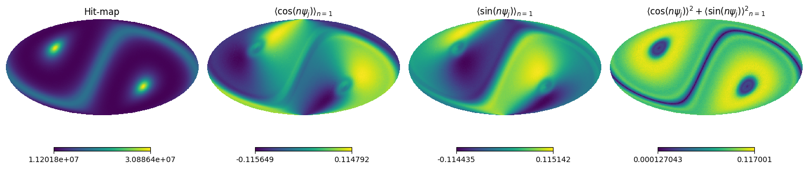

# Spin-based map-making simulation

<p align="center">
  
</p>

<p align="center">
  <h1>
  
  </h1>
</p>


SBM assesses the impact of systematic effects on CMB polarization
observations in spin space. The scan of a detector is reduced to its
orientation functions (h-maps, from [litebird_sim](https://github.com/litebird/litebird_sim)
or [Falcons.jl](https://github.com/yusuke-takase/Falcons.jl)), the data to the
spin components of a signal model, and the binned map-maker to a small linear
system in every pixel.

```python
import sbm
from sbm import systematics as sy

hmaps = sbm.HMaps.load("h_maps_det_A.h5")      # an h-map file of litebird_sim / Falcons.jl
sky = sbm.Sky.from_maps(*sbm.generate_cmb(nside=hmaps.nside, cmb_seed=1))
model = sy.sky_signal(sky, hwp=True) + sy.abs_pointing(sky, rho_rad=1e-4, chi_rad=0.3)
iqu = sbm.map_make((hmaps, model), sbm.Basis.iqu(hwp=True)).iqu
```

# Installation

```
git clone https://github.com/yusuke-takase/SBM.git
cd SBM
pip install -e .                 # or: uv pip install -e .
pip install -e ".[test]"         # pytest and SciPy for the tests
```

SBM needs NumPy (1.x or 2.x), healpy, h5py and ducc0. The extras `minuit`,
`low-ell` and `plot` add iminuit (`forecast(method="minuit")`), sympy
(`low_ell="beam_sum"`) and matplotlib (`get_cmap`).

# Documentation

The manual (formalism, conventions and their relation to litebird_sim, the
systematics, how to add one, the tests and the migration from the former API)
is in `docs/`; build it with

```
pip install -e ".[docs]"
python -m sphinx -b html docs/source docs/build/html
```

# Systematics

`sbm.systematics` returns the signal model of each systematic; models add up.

- Differential gain, differential pointing and bandpass mismatch of a pair difference
- Absolute pointing offset with HWP [Y. Takase et al.](https://arxiv.org/abs/2408.03040)
- HWP wedge (pointing disturbance rotating with the HWP)
- HWP instrumental polarization [G. Patanchon et al.](https://iopscience.iop.org/article/10.1088/1475-7516/2024/04/074)
- Second-order pointing terms
- Arbitrary beams, with a general HWP Mueller matrix
- White noise with the correlations of the map-maker

# Tests

`pytest` (from any directory). Every test compares SBM with an independent
computation: TOD simulated in real space and fitted by least squares, the sky
sampled at the offset pointing, direct Wigner sums, and the TOD model of
litebird_sim.

# How to cite the code

The basic formalism is published in [Y. Takase et al., 2024](https://arxiv.org/abs/2408.03040) and [Thesis of Y. Takase, 2025](https://arxiv.org/abs/2503.03176).
Please cite the paper when you use the SBM for your publications.

Citation information of the thesis:
```
@ARTICLE{Takase2025,
       author = {{Takase}, Yusuke},
        title = "{Design of the full-sky scanning strategy and systematic effect control in a cosmic microwave background probe}",
      journal = {arXiv e-prints},
     keywords = {Astrophysics - Cosmology and Nongalactic Astrophysics, Astrophysics - Instrumentation and Methods for Astrophysics},
         year = 2025,
        month = mar,
          eid = {arXiv:2503.03176},
        pages = {arXiv:2503.03176},
          doi = {10.48550/arXiv.2503.03176},
archivePrefix = {arXiv},
       eprint = {2503.03176},
 primaryClass = {astro-ph.CO},
       adsurl = {https://ui.adsabs.harvard.edu/abs/2025arXiv250303176T},
      adsnote = {Provided by the SAO/NASA Astrophysics Data System}
}
```
